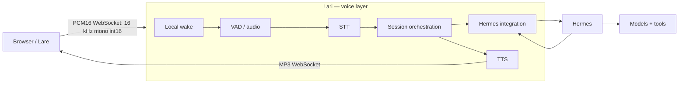

<p align="center">
  
</p>

# Lari

Lari is a self-hosted hands-free voice satellite for [Hermes](https://github.com/NousResearch/hermes-agent). A browser/PWA or the Qt desktop app supplies the microphone and speaker. Hermes owns the assistant, models, conversation memory and tools; Lari handles wake detection, audio, STT and TTS. Dedicated hardware is future work.

## How it works



Local wake detection and VAD collect an utterance before STT. Hermes receives the command and streams its reply; Lari synthesizes speech and sends MP3 audio to the satellite. Playback completion opens a local follow-up window without another wake phrase. Manual conversation buttons bypass wake detection for a turn.

Satellites use the same WebSocket protocol. The device contract supports `?device=phone` and separate Hermes session keys; see [protocol and checkout compatibility](docs/protocol.md#device-identity-and-status).

## Requirements

Python 3.11/3.12, Hermes with its API server enabled, and an extracted Vosk model for local wake detection. The default local Whisper path also needs its model available. Mobile microphone access requires HTTPS; localhost is exempt. Desktop use adds PySide6 and a graphical session with tray support; its native flame companion roams the desktop and offers conversation and local PC controls. A Hermes checkout is needed only for the optional Hermes wake engine or CLI fallback.

## Quick start

```bash
git clone https://github.com/matteo-genovese/lari.git
cd lari
./setup.sh
```

Review the generated private `.env`: configure the Hermes API and credentials, and keep `LARI_TOKEN` secret. Setup downloads the Italian Vosk model and installs dependencies; it preserves an existing `.env`. The template selects local Whisper STT. Then run:

```bash
set -a
. ./.env
set +a
.venv/bin/python -m lari.server
```

`LARI_HOST` selects the bind IPv4 address or hostname (default: `127.0.0.1`);
`LARI_PORT` defaults to `8643`. Two private exposure models are supported:

- Keep `LARI_HOST=127.0.0.1` and use Tailscale Serve to expose
  `http://127.0.0.1:8643` as private HTTPS. This is the model for mobile browsers,
  which require HTTPS for microphone access.
- Set `LARI_HOST` to the host's tailnet address (for example `100.76.72.58`)
  for clients connecting directly through the tailnet. The bridge still serves
  plaintext HTTP/WebSocket; Tailscale encrypts transport, but this does not provide
  the HTTPS origin required by mobile browsers for microphone access.

Open the token-scoped page and press **Start listening**. Keep the phone awake and the page foregrounded. The bridge can invoke Hermes tools: keep its token and network access private.

See [installation](docs/installation.md) for manual setup, systemd, HTTPS and a WebSocket probe, or [desktop](docs/desktop.md) for the tray app.

## Documentation

| Document | Contents |
| --- | --- |
| [Index](docs/README.md) | Documentation map |
| [Architecture](docs/architecture.md) | Module boundaries, settings and per-session state |
| [Installation](docs/installation.md) | Dependencies, services, HTTPS and verification |
| [Configuration](docs/configuration.md) | Every `LARI_*` setting read by `lari/config.py` |
| [Protocol](docs/protocol.md) | WebSocket frames, HTTP routes, device identity and status |
| [Desktop](docs/desktop.md) | Native companion, voice, PC controls, installer and remote client |
| [Integrations](docs/integrations.md) | Status bar, Hermes tunnel and other clients |
| [Calibration](docs/calibration.md) | Wake phrase, VAD, follow-up and echo |
| [Troubleshooting](docs/troubleshooting.md) | Logs, probes and known failure modes |

## The name

Roman households kept Lares: spirits of the hearth and family. Lari takes its name from them; each satellite is a Lare, represented by a flame. In the artwork, the Lare rides on Hermes' shoulder: the satellite and its assistant.

## License

[MIT](LICENSE) © 2026 Matteo Genovese.
